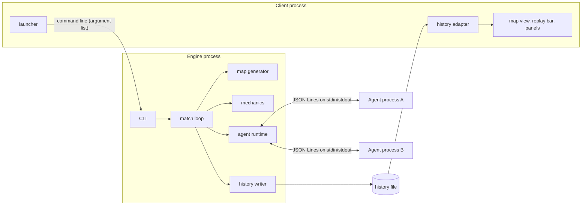
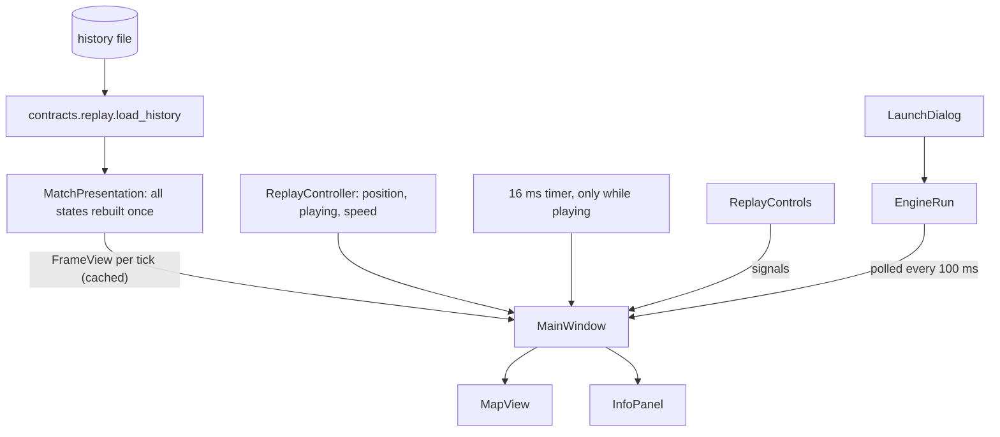

# Software Design Document — Neon Armada: Endgame

**Version:** 1.0 (delivery L12, 2026-11-16)
**Contract versions described:** game models 1, agent protocol 1, history format 1,
engine CLI 1, map generator 1
**Assignment:** <https://ocw.cs.pub.ro/courses/mps/proiect> (page last modified 2026-10-21)

## 1. Purpose and scope

Neon Armada: Endgame is a local, two-player strategy simulation in which each player is
an autonomous program (an *agent*). The product has three parts that the assignment
requires to be decoupled:

1. a deterministic, headless **engine** that plays a match between two agents;
2. **agents**, independent programs written with the starter kits;
3. a graphical **client** that starts matches and replays their histories.

Out of scope, as in the assignment: network play, accounts, hosting of other people's
agents, isolation of hostile code, and all optional features.

This document describes the structure that exists in the repository. Exact data shapes
and rule decisions are normative in [`contracts/`](../../contracts/README.md) and are
not repeated in full here.

## 2. System overview



There are four operating-system processes in a match started from the client: the
client, the engine and the two agents. The only connections are:

| Boundary | Mechanism | Contract |
| --- | --- | --- |
| client → engine | process start with an argument list; exit code; one JSON line on the engine's stdout, redirected to a file | [engine-cli.md](../../contracts/engine-cli.md) |
| engine → client | the history file | [history-format.md](../../contracts/history-format.md) |
| engine ↔ agent | JSON Lines over the agent's stdin and stdout | [agent-protocol.md](../../contracts/agent-protocol.md) |

No function call, shared memory, socket or pipe links the client and the engine.

## 3. Module structure

```text
src/neon_armada/
  contracts/          shared by engine and client; no Qt, no processes
    versions.py       version numbers of the four contracts and of the generator
    models.py         MatchConfig, StaticMap, MatchState, Ship, commands, MatchResult
    fingerprint.py    canonical JSON of a state and its SHA-256
    protocol.py       building and parsing of protocol messages
    history.py        validation of a history document
    replay.py         history reader, reconstruction from events, comparison
    cli.py            engine module name and exit codes
  engine/
    world/rng.py, world/generator.py    SplitMix64, symmetric map, reachability, retry
    core/mechanics.py                   validation and the tick transition, end, winner
    agents/runtime.py, agents/limits.py agent processes, timeouts, memory limit
    match.py                            match loop, produces a MatchRecord
    history/writer.py                   MatchRecord to history file
    cli.py, __main__.py                 run, validate, compare, check-determinism
  client/
    presentation.py   history to immutable FrameView objects (no Qt)
    replay.py         ReplayController: position, play state, speed (no Qt)
    launcher.py       builds the engine command, starts and observes the process (no Qt)
    widgets/          MapView, InfoPanel, ReplayControls, LaunchDialog
    main_window.py, app.py, __main__.py
agents/python/, agents/cpp/   starter kits and agents; they import nothing from src/
```

### Dependency rules

| Package | May import | Must not import |
| --- | --- | --- |
| `contracts` | standard library | `engine`, `client`, PySide6 |
| `engine` | `contracts`, standard library | `client`, PySide6 |
| `client` | `contracts`, PySide6, standard library | `engine` |
| agents | their own starter kit | anything under `src/` |

These rules are enforced by tests that parse the import statements of every module:
`tests/unit/contracts/test_contract_history_cli.py` (contracts),
`tests/unit/engine/test_match_loop.py` (engine), `tests/unit/client/test_presentation.py`
(client) and `tests/unit/agents/test_python_agent_kit.py` (Python agent kit). The client's only knowledge of the engine is the module name
`neon_armada.engine`, a string constant in `contracts/cli.py` used to build the command.

## 4. Engine design

### 4.1 Map generator (`engine/world`)

- Input: map size (32–64) and seed. Output: a `StaticMap` (cells and the two bases) and
  the initial energy cells.
- A candidate is built for one half of the grid and copied to the other half by a 180°
  rotation, which gives both players the same opportunities.
- Random numbers come from a SplitMix64 generator implemented in the repository, so maps
  do not depend on the Python version or platform.
- A breadth-first traversal from each base checks that every deposit can be reached from
  both bases. An invalid candidate is discarded and the next attempt uses a seed derived
  from the original seed and the attempt number. After 100 attempts the generator fails
  with `MapGenerationError` (CLI exit code 4).
- Densities, energy range, base placement and the derived-seed formula are team decisions
  recorded in section 9 of the game-models contract.

### 4.2 Mechanics (`engine/core/mechanics.py`)

Pure functions over immutable values, with integer arithmetic only:

- `create_initial_state` — 1000 energy and one ship per player.
- `validate_commands` — separates accepted commands from invalid ones (which are counted
  and recorded but otherwise ignored).
- `resolve_tick` — applies phases 4–9 of the official tick order to a state and returns
  the new state together with the events that describe the change.
- `end_reason`, `decide_winner`, `build_result` — end of match, score and tie-break.

The official tick order is kept exactly:

1. send observations; 2. read commands within the time limit; 3. validate;
4. construction; 5. simultaneous movement; 6. collisions; 7. mining by ships that did
not move; 8. delivery at the own base; 9. budgets, fingerprint, history events.

Movement is computed for all ships from the same starting state and then applied at once,
so neither player is processed "first". Two ships that exchange cells do not collide;
ships on a base cell are never destroyed.

### 4.3 Agent runtime (`engine/agents`)

- Each agent is a child process of the engine with its stdin and stdout connected to
  pipes; a `.py` agent is started with the engine's interpreter, anything else is
  executed directly. Commands are argument lists, never shell strings.
- Background threads per agent read its output and write its input, so that the match
  loop can wait with a deadline and never blocks on an agent that is silent or has
  stopped reading. Lines longer than 65 536 bytes and
  standard-error output are bounded.
- A missed deadline loses the tick (the agent's ships stay still). Three consecutive
  timeouts exclude the agent; the match continues. A late answer to an earlier tick is
  discarded. A malformed answer is counted as an invalid command, not as a timeout.
  A crashed agent is excluded with the reason recorded.
- Memory limit: a Windows Job Object, or `RLIMIT_AS` on Linux. On macOS no limit is
  applied. This protects the engine from faulty agents; it is not a sandbox.

### 4.4 Match loop and CLI (`engine/match.py`, `engine/cli.py`)

`run_match` generates the map, initialises both agents, then repeats the tick order
until 500 ticks have been played or both movement budgets are exhausted and no ship can
still collect. It returns a `MatchRecord`: configuration, map, initial state, per-tick
events and fingerprints, result and timing. The loop contains no game rules of its own;
it calls the mechanics functions.

The CLI turns arguments into a `MatchConfig`, runs the match, writes the history to a
temporary file that is renamed at the end (a reader never sees a partial file), prints
one JSON line and returns an exit code. `validate`, `compare` and `check-determinism`
use the shared reader in `contracts/replay.py`.

## 5. History and determinism

- A history is one JSON document: header (versions, seed, configuration, agent names),
  map, initial state and its fingerprint, set-up events, one entry per tick (events and
  fingerprint) and the result.
- Events are deltas (`ship_moved`, `collision`, `mined`, `delivered`, `build_started`,
  `ship_spawned`, `invalid_command`, `malformed_response`, `timeout`, `agent_excluded`).
  The contract gives each event a normative "state effect", so any state can be rebuilt
  from the initial state and the events alone, without game rules or agents.
- The fingerprint of a state is the SHA-256 of its canonical JSON form (fixed key order,
  ships by id, energy cells row by row). Only integer simulation state is hashed: no
  timestamps, paths, names or timing.
- `apply_events` / `reconstruct_states` implement the state effects; `first_invalid_tick`
  checks every rebuilt state against its recorded fingerprint; `compare_histories`
  reports the first tick at which two matches differ.

## 6. Client design



- **Adapter.** `MatchPresentation` rebuilds every state when a file is opened and turns a
  tick into an immutable `FrameView` (cells, energy, ships, per-player statistics, event
  summary, result). Widgets only see `FrameView`.
- **Replay.** `ReplayController` keeps a position measured in ticks as a real number. Its
  integer part selects the frame, its fraction is the interpolation progress used by
  `MapView` to draw ships between two cells. Wall-clock time moves the position; nothing
  is simulated. Seeking is a jump to a rebuilt state, so it costs the same for any tick.
- **Rendering.** `MapView` paints with `QPainter`. Terrain, grid and bases are cached in
  a pixmap per map and widget size; energy cells, collision marks and ships are drawn on
  top for every frame.
- **Launching.** `EngineRun` starts the engine detached from the client (Windows: new
  process group, detached, outside the client's job object when allowed; POSIX: new
  session), with its output redirected to files next to the history. The window polls
  the process with a timer, so the interface stays responsive, and opens the history
  when the exit code is 0. Any other outcome is shown in the error banner with the
  engine's message. Because nothing connects the two processes, a client that is closed
  or killed leaves the engine running until it has written its history.

## 7. Agents

The Python kit (`agents/python/neon_agent_kit.py`) and the header-only C++17 kit
(`agents/cpp/include/neon_agent_kit.hpp`) implement the message loop and offer map
helpers (bounds, passable cells, shortest paths). An agent supplies one `decide`
function. The reference agent is a greedy single-ship collector; the team agent builds
additional ships, scores targets by distance and energy, and avoids cells where an
enemy ship could arrive.

## 8. Design decisions

| Decision | Reason | Consequence |
| --- | --- | --- |
| One shared `contracts` package | engine and client must agree on shapes without importing each other | a change of shape is a contract change with a version increment |
| History stores event deltas, not full states | small files; events also drive the client's event list | the reader must implement the state effects; verified against fingerprints |
| JSON Lines protocol | readable, available in every language's standard library | larger messages than a binary format; acceptable at 64x64 |
| Own SplitMix64 generator | identical maps on every platform and Python version | no use of `random` in the generator |
| Client observes the engine through files | required decoupling; survives a client crash | the client cannot show progress inside a match, only elapsed time |
| Replay position as a real number of ticks | interpolation and speed without touching simulation state | frames between ticks are drawn, not stored |
| Rule gaps resolved as documented team decisions | the assignment asks for added rules to be documented | listed in `contracts/README.md`; coordinator confirmation still to be recorded |

## 9. Testing and reproducibility

| Level | Location | Examples |
| --- | --- | --- |
| Contract | `tests/unit/contracts`, `tests/fixtures/contracts` | valid and invalid messages, history schema, reconstruction |
| Unit | `tests/unit/{world,core,engine,agents,client}` | symmetry, collisions, tie-break, replay controller, launcher |
| Integration | `tests/integration` | faulty agents, CLI exit codes, GUI offscreen, launcher with a fake engine |
| Determinism | `tests/determinism` | same seed twice, first divergent tick |
| End-to-end | `tests/e2e`, `tests/integration/test_client_launch.py` | agents → engine → file → client; engine survives a killed client |

GUI tests run without a display through Qt's `offscreen` platform (set in
`tests/conftest.py`). Commands, environment and measured results are in
[the test report](../reports/test-report-L11.md).

## 10. Limitations

- Verified on Windows 11 only; no CI pipeline run has been verified.
- No memory limit for agents on macOS; no protection against hostile agents anywhere.
- Ships destroyed in a collision are not animated towards the collision cell.
- The client shows only elapsed time while a match is running.
- C++ formatting could not be checked by tool on the development machine
  (`clang-format` 12 cannot read the repository's configuration).
