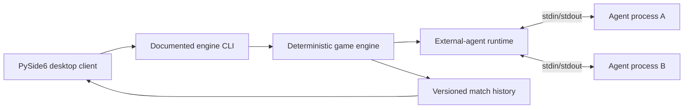

# Architecture Overview

**Status:** E00 baseline. The interfaces named below are draft contracts, not
implemented APIs.

Neon Armada is organized around a deterministic simulation engine, an
external-agent runtime, a PySide6 desktop client, and independent reference
agents. The MPS specification requires the engine and client to be decoupled:
the client starts the engine through a documented CLI and later reads a complete
history file. No GUI code is imported by the engine.

## Component responsibilities

- **Game engine:** owns game state, deterministic world generation, turn
  resolution, scoring, termination, and history production.
- **Agent runtime:** launches agents as child processes, exchanges protocol
  messages, applies resource limits, and reports protocol failures to the
  engine. Agents are never imported into the engine.
- **Desktop client:** chooses local agent launch specifications and seed, invokes
  the engine through its CLI, then loads and plays the generated history.
- **Reference agents:** independent Python and C++17 processes that implement
  the documented protocol once it is approved.

## Dependency direction

The engine may depend on its domain and runtime abstractions, but never on the
client or PySide6. The client depends on documented CLI and history contracts,
not on engine internals. Reference agents depend only on the agent-protocol
contract. The history reader and writer share only the approved history contract.

## Integration boundaries

The agent protocol, engine CLI, and history format are maintained under
[`contracts/`](../../contracts/README.md). Their concrete versions are an E01
decision. A history file is the durable handoff from an engine match to visual
playback, enabling the client to remain independent while a match executes.
